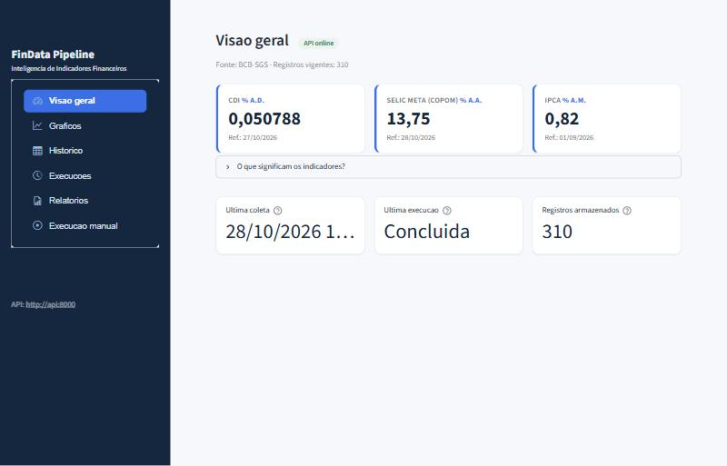
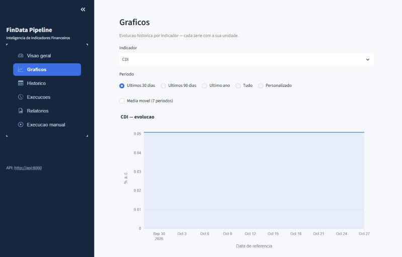
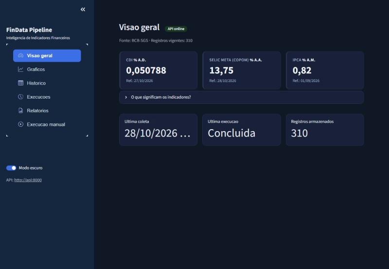

# FinData Pipeline


[](https://github.com/astral-sh/ruff)
[](https://mypy-lang.org/)

**Plataforma de Inteligência de Indicadores Financeiros.** Coleta, valida,
versiona e armazena indicadores financeiros públicos do Banco Central do Brasil
(CDI, Selic, IPCA) e os disponibiliza por uma **API REST** e um **dashboard**.

> **Natureza do projeto.** Demonstração técnica para fins educacionais e de
> portfólio. **Não** acessa sistemas internos nem dados privados de nenhuma
> empresa, e **não** está em produção. Todos os números deste README foram
> gerados por execuções locais reais contra a API pública do BCB. Não há link de
> demonstração hospedada.

O projeto segue uma disciplina de **desenvolvimento guiado por provas**:
**evidência acima de afirmação** — um recurso só é considerado pronto quando a
sua jornada passa na última execução. Ver [docs/INDEX.md](docs/INDEX.md), o roadmap com provas em
[docs/product/ROADMAP_AND_ACCEPTANCE.md](docs/product/ROADMAP_AND_ACCEPTANCE.md)
e as jornadas em [docs/journeys/JOURNEYS.md](docs/journeys/JOURNEYS.md).

---

## Capturas de tela

| Visão geral | Gráficos |
|---|---|
|  |  |

Capturas reais do dashboard rodando via Docker, com dados coletados do BCB.
O dashboard tem **modo claro e escuro**, alternável na barra lateral:



## Objetivo e problema

Em crédito estruturado, operações são indexadas a taxas de mercado ("CDI +
spread", "IPCA + taxa"). Trabalhar com esses números exige **rastreabilidade**,
**precisão decimal** e **idempotência**. Este projeto demonstra essas três
garantias, da coleta à visualização.

## Funcionalidades

- **Pipeline** (CLI): coleta da API SGS, validação ciente da série com `Decimal`,
  SQLite idempotente e **versionado** (revisões não sobrescrevem o histórico),
  relatórios, alertas e coleta agendada.
- **API REST** (FastAPI): indicadores, histórico paginado, execuções,
  relatórios e saúde — com Swagger. Reutiliza o pipeline (não reimplementa
  regra de negócio).
- **Dashboard** (Streamlit): visão geral, gráficos (Plotly), histórico com
  export CSV, execuções, relatórios e execução manual — consumindo **só a API**.
- **Docker Compose**: sobe tudo com um comando, com SQLite persistente.

## Arquitetura (diagrama de componentes)

```
            +---------------------------------------------+
  Navegador |  Dashboard (Streamlit)  :8501               |
  ========> |  client.py --- HTTP ---> API                |
            +----------------+----------------------------+
                             | http://api:8000 (rede interna)
            +----------------v----------------------------+
            |  API REST (FastAPI/Uvicorn)  :8000  /docs   |
            |  routes --> services --> pipeline           |
            +--------+---------------------------+--------+
                     | coleta (BackgroundTask)   | consulta (leitura)
                     v                           v
            +----------------+          +---------------------+
            | Pipeline       |  escreve | SQLite (volume)     |
            | scraper->valid | =======> | /data/findata.db    |
            | ->database     |          +---------------------+
            +-------+--------+
                    | HTTP (SGS)
                    v
            API publica do BCB (so na coleta)
```

- A **coleta** só acontece pelo fluxo do pipeline (a API dispara em tarefa de
  segundo plano). O **dashboard nunca** consulta o SQLite direto nem o BCB — só
  a API da aplicação.
- Os **valores** trafegam como **string** (texto canônico do `Decimal`), nunca
  convertidos para `float` na camada de negócio.

## Tecnologias

Python 3.12 · requests · pandas · BeautifulSoup4 (adaptador HTML) · SQLite ·
pytest · **FastAPI** · **Uvicorn** · **Pydantic** · **Streamlit** · **Plotly** ·
**Docker / Docker Compose**.

## Estrutura de pastas

```
findata-pipeline/
├── src/findata_pipeline/
│   ├── config.py scraper.py validator.py database.py reporter.py
│   ├── alerts.py html_source.py main.py        # pipeline-base (v1)
│   ├── api/                                     # API REST (v2)
│   │   ├── app.py deps.py runner.py schemas.py services.py
│   │   └── routes/ (health, status, indicators, runs, reports)
│   └── dashboard/                               # Dashboard (v2)
│       ├── app.py client.py format.py
├── tests/                 # pytest; fixtures; test_contract (marcado)
├── docs/                  # INDEX, process/, product/, journeys/
├── Dockerfile · docker-compose.yml · .dockerignore
├── requirements.txt · pyproject.toml · .env.example · README.md
└── .github/workflows/     # ci.yml e scheduled.yml
```

## Pré-requisitos

- **Local:** Python 3.12.
- **Docker:** Docker Engine + Docker Compose v2.

## Configuração de ambiente

Variáveis em `.env` (ver [.env.example](.env.example)): `DB_PATH`, `LOG_LEVEL`,
`REQUEST_TIMEOUT`, `REPORTS_DIR`, `CORS_ORIGINS`, `API_WRITE_TOKEN`,
`API_BASE_URL`, `API_PUBLIC_URL`.

## Execução local (sem Docker)

```bash
# Ambiente
py -3.12 -m venv .venv
.\.venv\Scripts\python -m pip install -r requirements.txt   # Windows
# python3.12 -m venv .venv && .venv/bin/pip install -r requirements.txt  # Linux/macOS

# 1) Pipeline (coleta real; gera data/findata.db e um relatório)
$env:PYTHONPATH="src"; .\.venv\Scripts\python -m findata_pipeline.main --days 180

# 2) API (http://localhost:8000, Swagger em /docs)
$env:PYTHONPATH="src"; .\.venv\Scripts\python -m uvicorn findata_pipeline.api.app:app --port 8000

# 3) Dashboard (http://localhost:8501) — precisa da API no ar
$env:PYTHONPATH="src"; $env:API_BASE_URL="http://localhost:8000"
.\.venv\Scripts\python -m streamlit run src/findata_pipeline/dashboard/app.py
```

## Execução com Docker Compose (um comando)

```bash
docker compose up --build
```

- **Dashboard:** http://localhost:8501
- **API + Swagger:** http://localhost:8000/docs

A subida **não exige passos manuais**: a API cria/migra as tabelas no start. A
coleta inicial roda pela página *Execução manual* do dashboard (ou `POST /runs`).

## Exemplos de requisição/resposta (reais)

```http
GET /api/v1/indicators/BCB-SGS-12/latest
```
```json
{"series_id":"BCB-SGS-12","has_data":true,
 "observation":{"series_id":"BCB-SGS-12","source":"BCB-SGS",
 "reference_date":"2026-10-27","value":"0.050788","unit":"percent_per_day",
 "collected_at":"2026-10-28T16:19:08Z","version":1,"is_current":true,
 "superseded_at":null}}
```

```http
GET /api/v1/indicators/BCB-SGS-433/history?limit=2
```
```json
{"series_id":"BCB-SGS-433","total":4,"limit":2,"offset":0,"count":2,
 "items":[{"reference_date":"2026-09-01","value":"0.82","unit":"percent_per_month","is_current":true, "...": "..."}]}
```

```http
POST /api/v1/runs      {"days": 120}
→ 202 {"run_id": 2, "status": "running", "message": "Execucao aceita ..."}
```

Uma segunda chamada simultânea recebe **409**. Com `API_WRITE_TOKEN` definido,
`POST /runs` exige o header `X-API-Token`.

## Testes

Ferramentas de dev/teste ficam em `requirements-dev.txt` (fora da imagem de
produção): `pip install -r requirements-dev.txt`.

```bash
ruff check .                                                # lint + ordem de imports
mypy                                                        # checagem de tipos
.\.venv\Scripts\python -m pytest -v --cov=findata_pipeline  # offline + cobertura
.\.venv\Scripts\python -m pytest -m contract --run-contract # contrato (API real do BCB)
```

Cobrem pipeline, API (health, indicadores, histórico/paginação, validação 422,
série inexistente 404, execução 202, conflito 409, download seguro e bloqueio de
path traversal) e as funções puras do dashboard. **78 testes offline + 3 de
contrato**, cobertura ~77% (o núcleo entre 84% e 96%; a UI do Streamlit não é
unit-testada). O CI roda ruff, mypy e os testes com cobertura. Os testes comuns
não acessam a internet nem disparam coleta real.

## Persistência, backup e restauração

O SQLite vive no volume `findata-pipeline_findata-data` (montado em `/data`).

| Ação | Comando | Efeito nos dados |
|------|---------|------------------|
| Parar | `docker compose stop` | preservados |
| Recriar | `docker compose down` + `up` | **preservados** (volume fica) |
| Remover volumes | `docker compose down -v` | **apagados** |
| Backup | `docker compose cp api:/data/findata.db ./findata-backup.db` | cópia do `.db` |
| Restaurar | `docker compose cp ./findata-backup.db api:/data/findata.db` e reiniciar | — |

A inicialização normal **nunca** apaga dados. (Verificado: após `down` + `up`,
209 observações permaneceram.)

## Segurança e limitações conhecidas

- O endpoint de escrita `POST /runs` é protegível por token (`API_WRITE_TOKEN`,
  comparação segura com `secrets.compare_digest`). Em ambiente estritamente
  local pode ficar aberto; **para exposição externa, defina o token**.
- Download de relatórios valida o caminho (bloqueia *path traversal*); só serve
  arquivos `.json`/`.csv` dentro de `REPORTS_DIR`.
- O banco **não** é exposto em porta; só a API o acessa.
- Concorrência de execução é controlada por lock de processo + marca persistente
  (`status="running"`) → **vale para 1 processo**; múltiplos workers exigiriam um
  lock no banco.
- **Rate limit** no `POST /runs` (HTTP **429** quando excede a janela), além do
  controle de concorrência (409). Configurável por `RUN_RATE_LIMIT_MAX`/`_WINDOW_S`.
- **Alerta de frescor** (`stale_data`): avisa quando uma série parou de atualizar
  além do limite da sua periodicidade.
- **Não** considere pronto para exposição pública só porque roda localmente.
- `beautifulsoup4` é usado pelo adaptador HTML (fonte alternativa); a fonte
  principal (SGS) é JSON.

## Melhorias futuras

1. Canais de alerta externos (webhook/e-mail) além do log.
2. Autenticação/lock de execução compartilhado para múltiplos workers.
3. Mais séries e a fonte HTML do Tesouro integrada ao fluxo.

## Decisões técnicas

- **SQLite (e não PostgreSQL):** volume pequeno e foco num sistema coeso e fácil
  de rodar. SQLite com WAL atende a leitura concorrente API↔pipeline sem um
  servidor de banco extra. Migrar agora seria prematuro.
- **`Decimal` como texto (e não `float`):** `float` é binário e acumula erro em
  taxas; o valor é guardado e trafega como **string canônica**.
- **Sem Celery/Redis para execução assíncrona:** um `ThreadPoolExecutor(1)` +
  lock executa a coleta fora da requisição, com status persistido em `runs`.
  Celery/Redis seriam complexidade sem necessidade concreta neste tamanho.
- **A API reutiliza o pipeline:** nenhuma regra de negócio é reimplementada — a
  camada de serviços chama `run_pipeline`/`Database`, preservando idempotência,
  versionamento e rastreabilidade.
- **`streamlit-option-menu`:** biblioteca leve e mantida para uma navegação
  profissional, sem adotar um framework de UI pesado.

## Documentação

Hub em [docs/INDEX.md](docs/INDEX.md): entrega ([DELIVERY](docs/process/DELIVERY.md)),
roadmap com provas ([ROADMAP_AND_ACCEPTANCE](docs/product/ROADMAP_AND_ACCEPTANCE.md))
e jornadas ([JOURNEYS](docs/journeys/JOURNEYS.md)).
